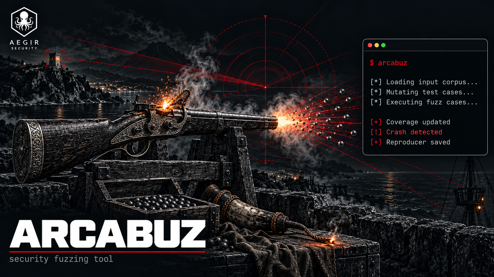

# Arcabuz



> *El disparo del arcabuz se dispersa — cada proyectil busca la brecha.*

Multi-tool fuzzing dockerizado para bug bounty. 4 herramientas, 4 modos,
resultados deduplicados. Un comando, output limpio.

**Herramientas:**

| Tool | Lenguaje | Fortaleza |
|---|---|---|
| **ffuf** | Go | Velocidad + flexibilidad |
| **gobuster** | Go | Fiabilidad + DNS |
| **dirsearch** | Python | Extensiones inteligentes |
| **feroxbuster** | Rust | Recursividad automática |

## Setup

```bash
git clone https://github.com/KarasuJager/arcabuz.git
cd arcabuz

cp .env.example .env
docker compose build    # primera build ~10 min (compila Go + Rust + descarga SecLists)
```

## Modos

```bash
# Fuzzear directorios/ficheros
docker compose run --rm arcabuz dirs -u https://target.com -w common.txt

# Con extensiones
docker compose run --rm arcabuz dirs -u https://target.com -w raft-medium-directories.txt -x php,asp,jsp

# Fuzzear subdominios
docker compose run --rm arcabuz subs -d target.com -w subdomains-top1million-5000.txt

# Fuzzear parámetros (GET + POST)
docker compose run --rm arcabuz params -u https://target.com/api/endpoint -w burp-parameter-names.txt

# Fuzzear virtual hosts
docker compose run --rm arcabuz vhosts -u https://target.com -d target.com -w subdomains-top1million-5000.txt
```

## Wordlists incluidas

De SecLists, las más usadas:

| Wordlist | Uso |
|---|---|
| `common.txt` | Directorios y ficheros comunes |
| `raft-medium-directories.txt` | Directorios (medium) |
| `raft-medium-files.txt` | Ficheros (medium) |
| `directory-list-2.3-medium.txt` | Directorios DirBuster (medium) |
| `api/api-endpoints.txt` | Endpoints de API |
| `burp-parameter-names.txt` | Nombres de parámetros |
| `subdomains-top1million-5000.txt` | Subdominios (top 5K) |
| `subdomains-top1million-20000.txt` | Subdominios (top 20K) |

Se pasan por nombre corto (sin path completo).

## Output

```
data/<mode>-<timestamp>/
├── raw/                resultados individuales de cada herramienta
│   ├── ffuf.json
│   ├── gobuster.txt
│   ├── dirsearch.json
│   └── feroxbuster.txt
└── merged/
    ├── unique-results.txt   resultados deduplicados + confirmación cruzada
    ├── duplicates.txt       duplicados eliminados
    └── results.json         JSON para triage con FuzzRank
```

Cada resultado muestra cuántas herramientas lo encontraron:
```
/admin (301) [3x: ffuf, gobuster, dirsearch]    ← confirmado por 3
/backup (200) [feroxbuster]                      ← solo recursivo lo encontró
/api/v2/internal (403) [2x: ffuf, gobuster]      ← interesante, 403
```

## En el flujo AEGIR

```
Atalaya  → OSINT pasivo (Fase 1)
VIGÍA    → recon activo + JS + Nuclei (Fase 2)
Arcabuz  → fuzzing de lo que OSINT/recon no encuentran (Fase 3-4, si el programa lo permite)
Tercios  → agentes procesan todo → hipótesis
```

Arcabuz es **independiente** de VIGÍA y Atalaya. Si el programa prohíbe fuzzing
automático, no se usa y el resto del flujo no se afecta.

## Responsible use

Solo para **bug bounty autorizado** que permita fuzzing/brute-force.
Verificar la automation policy del programa antes de lanzar.
Tráfico identificado con User-Agent de bug bounty.

---

Built by [Manuel Miguel Fernandez-Gallego Olivares](https://www.linkedin.com/in/manuel-miguel-olivares)
· Offensive Security Engineer · parte del toolkit AEGIR junto a
[Atalaya](https://github.com/KarasuJager/ATALAYA) (OSINT),
[VIGÍA](https://github.com/KarasuJager/Vigia) (recon),
[Huginn](https://github.com/KarasuJager/huginn) (AI pentest) y
[SONDA](https://github.com/KarasuJager/sonda) (differential HTTP testing).
